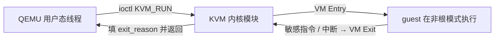

## 看到B站一个视频，看不懂

视频在这里：[什么是 KVM](https://www.bilibili.com/video/BV1Jfx96XExd/)。之前也刷到过类似的文章，但一直是"完全不懂、不了解"的状态 —— 知道 KVM 这个词，不知道它到底干了什么。

同时还有件事一直没弄明白：我在用 wsl2，文档里说它的性能接近原生，理由是"**不是虚拟的，是真的 linux 内核跑在物理 CPU 上**"。这句话我当时是信的，但完全说不清为什么 —— 虚拟和不虚拟，到底差在哪？

正好这段时间在看linux驱动相关知识，看到这段代码就一路追问下去：


---

## 第 1 问：ioctl 是什么？

> 一般来说，用户空间想要给内核的东西传递数据，不是 write 系统调用吗？ioctl 是系统调用吗？也是直接通过系统调用把数据传递给内核？

`write` 确实是最基础的，但它只能做一件事：**把一段连续字节写进设备**。它有三件事干不了：

- **表达不了"命令"**。你不能用 `write` 告诉设备"把波特率设成 115200"，只能灌一串数据流；
- **回不了头**。`write` 是单向的，内核想把"配置成功没有"告诉你，没地方放；
- **装不下结构体**。把结构体强转成 `char *` 写进去，内核怎么解析？没有约定。

`ioctl` 就是为这些场景设计的，它是标准的系统调用：

```c
int ioctl(int fd, unsigned long request, ...);
```

- `request` 是**命令码**，每个驱动定义一套，比如 KVM 的 `KVM_CREATE_VM`、`KVM_RUN`；
- 第三个参数是**可变参数**，可以是个整数、一个结构体指针，甚至省略。指针方向是双向的 —— 既能送进去，也能收回来。

| | `write` | `ioctl` |
| --- | --- | --- |
| 用途 | 传输数据流 | 设备控制、状态查询、配置 |
| 方向 | 基本是用户 → 内核 | 双向 |
| 数据格式 | 连续字节 | 整数 / 结构体指针 / 省略 |
| 有没有语义 | 没有，只是"写" | 有，命令码决定做什么 |
| 典型场景 | 写文件、写串口 | 设波特率、创建虚拟机、配网卡 |

回到那段代码：

- `ioctl(kvm, KVM_CREATE_VM, 0)`：第三个参数是 0，**命令本身就是全部内容**；
- `ioctl(vm, KVM_SET_USER_MEMORY_REGION, &mem)`：**传结构体进去**，告诉内核"虚拟机的内存对应我用户态的哪一块"；

---

## 第 2 问：虚拟机在 Linux 眼里到底是什么？

概念清楚之后，我一口气问了五个：

> 1. 那看来这个虚拟机在 linux 看来就是一个线程/进程？
> 2. 这个虚拟机看来每次都要用户态的程序调用 run 才能跑起来？
> 3. 调用 run 函数之后，你说的当前的用户态线程会进入休眠，物理 cpu 硬件会去跑虚拟机的软件？（直接物理 cpu 跑他的指令？）
> 4. 是不是 cpu 的工作模式有好几种？比如跑虚拟机的指令的就是一种？我猜测：在调用 run 的时候，cpu 被设置成某种模式：这个模式下，只能运行部分指令，某些硬件操作或者别的指令不给执行，如果跑到了这条指令，那么就中断，退出来到 linux 内核里，cpu 也回到正常模式，等待用户态的程序处理好退出原因后，再次调用 run？
> 5. 那这样看来，虚拟机能吃到的真实的物理硬件资源还是太少了，或者说有什么办法可以给这个进程多一些 cpu 和其他硬件的资源？

前三问的答案都很干脆：**是、是、是**。但细节值得记：

1. **虚拟机是进程/线程吗？** 是。QEMU 是宿主机上一个普通用户态进程，里面每一个 vCPU 就是这个进程里的一个普通线程。注意 `ioctl(vm, KVM_CREATE_VCPU, 0)` 并没有创建线程，它只是在内核里准备好 vCPU 的数据结构；**真正的线程是 QEMU 自己起 pthread 建的**。
2. **每次都要用户态再调 run 吗？** 是。只要 guest 不碰敏感操作，`KVM_RUN` 就一直不返回，物理 CPU 持续执行 guest 指令；一旦它想碰硬件，就必然退出到用户态，QEMU 处理完再把它送回去。
3. **物理 CPU 直接跑 guest 指令吗？** 是。`KVM_RUN` 之后 CPU 切到客户机模式，直接执行虚拟机的机器码，绝大部分指令都是原生的。
4. **根模式/非根模式**
- **根模式（Root Mode）**：宿主机 Linux 和 KVM 待的地方；
- **非根模式（Non-root Mode）**：给虚拟机跑代码的"沙盒"；
- **VMCS**（虚拟机控制结构）里存着 KVM 预先配好的一张"黑名单"；
- guest 执行到黑名单上的指令（I/O、访问特殊内存），或者发生特定事件（外部中断），CPU 硬件立刻暂停虚拟机、保存现场、**自动切回根模式** —— 这一步叫 **VM Exit**；
- QEMU 处理完退出原因，再调 `KVM_RUN` 触发 **VM Entry**，把 CPU 送回非根模式接着跑。



---

## 第 3 问：硬件直通是啥？

> 1. 一个硬件宿主机不用，它不还是一个硬件吗？要想访问它，不还是得碰到虚拟模式下 CPU 的黑名单指令吗？
> 2. 难道说这个客户机再把这个硬件的寄存器映射到客户机的内存地址？这样一来，客户机对硬件的操作就成了对一块内存地址的读写（而且这块地址是分给客户机的，不需要宿主机再过一遍？）

**第 1 条：错** 客户机里装的是**针对这块真实硬件的真驱动**。它读写设备寄存器（MMIO）时，KVM 早把这段物理地址通过 **EPT（扩展页表）** 映射进客户机的地址空间了。CPU 的 MMU 一查表就能定位到设备，**硬件直接完成访问，根本不触发 VM Exit**。这就是直通的精髓：热路径上 KVM 内核和 QEMU 用户态完全不参与。

**第 2 条：前半对，后半错。**
"寄存器被映射成一段内存地址，客户机读写它等于读写内存" —— 对，走 EPT。
"不需要宿主机再过一遍" —— **错**。因为设备自己也会往内存里写数据（DMA），DMA 请求直接打到内存总线上，不经过 CPU，也就绕过了 EPT。如果不管，一块被直通的网卡就能通过 DMA 读写宿主机内核的内存，隔离就形同虚设。

所以这里必须有 **IOMMU**：插在设备和内存之间的硬件关卡，负责地址翻译 + 权限检查。KVM 给每个直通设备在 IOMMU 里建一张表："你只能碰属于这个客户机的物理内存，别的地方一律拒绝。"

---

## 第 4 问：MMIO 和 IOMMU 到底差在哪？

名字看着像，其实是两个层面：

**MMIO（Memory-Mapped I/O）** 解决的是 **CPU 怎么跟设备说话**：把设备的控制寄存器映射到一段物理地址上，读写这段地址就等于控制硬件。往某个地址写个 1，就是告诉设备"开始干活"。直通时 KVM 把这段地址通过 EPT 映射进客户机，所以客户机读写寄存器不需要陷入内核。

**IOMMU（Input/Output MMU）** 解决的是 **设备怎么跟内存说话**：设备用 DMA 往内存里灌数据，这条路上没有 CPU，也就没有 EPT 把关。IOMMU 就插在这里，做地址翻译和隔离。

| | MMIO | IOMMU |
| --- | --- | --- |
| 谁在用 | CPU 访问设备寄存器 | 设备自己访问内存（DMA） |
| 谁做地址翻译 | EPT | IOMMU 页表 |
| 不配会怎样 | 每次访问都退出，慢 | 设备能乱摸宿主内存，隔离崩了 |

所以我原来那句"不需要宿主机过一遍"，准确的说法是：**不需要宿主机的 CPU（软件）过一遍，但必须经过 IOMMU（硬件）过一遍**。这个硬件关卡，就是直通既快又安全的原因。

---

## 第 5 问：KVM 和 QEMU 是什么关系？

> kvm 是内核里的模块，负责提供系统调用对吗？那么 qemu 这些东西是啥？用户态的程序，利用 kvm 来操作虚拟机？或者说可以理解为对 kvm 的能力进行了封装？

理解完全正确。这两个角色的分工，是整个架构里最关键的一环：

- **KVM 是内核里的"发动机"**：只做最底层的事 —— 创建 VM、创建 vCPU、管客户机内存映射（EPT）、让 vCPU 在物理 CPU 上真正跑起来。它对用户态暴露的唯一接口就是 `/dev/kvm` 加一组 `ioctl`。它**不知道硬盘、网卡、显卡是什么**。
- **QEMU 是用户态的"设备经理"**：模拟一台完整计算机的所有外围设备（芯片组、PCI 总线、磁盘控制器、网卡、显卡、键鼠），并且把 KVM 那些晦涩的 `ioctl` 封装成 `-m 4G`、`-smp 4`、`-drive` 这样的命令行参数。

配合流程就是那段代码：

1. QEMU 打开 `/dev/kvm`；
2. `ioctl(KVM_CREATE_VM)` 建虚拟机；
3. `ioctl(KVM_SET_USER_MEMORY_REGION)` 告诉 KVM 内存在哪；
4. `ioctl(KVM_CREATE_VCPU)` + `mmap` 建 vCPU 和共享信箱 `kvm_run`；
5. 起线程死循环 `ioctl(vcpu, KVM_RUN)`。

当 guest 想读硬盘时：VM Exit → QEMU 看到退出原因 → QEMU 在用户态把真实硬盘的数据读出来塞进共享内存 → 再 `KVM_RUN` 送回去。

**没有 KVM，QEMU 也能跑**。它内置一个叫 TCG 的模块，把 guest 指令动态翻译成宿主指令 —— 功能不缺，就是慢一个数量级。所以 QEMU 启动时会去嗅探 `/dev/kvm`，有就用硬件加速，没有就退回软件翻译。

---

## 最后：我把整条链路复述了一遍，被纠了两处

聊到最后，我试着自己用大白话把四句话总结了一遍：

1. **硬件支持**：CPU 虚拟化技术，VMCS 负责根模式/非根模式切换，说白了就是给特定指令设权限，碰到就 VM Exit；
2. **硬件直通**：为了减少 exit 提高性能，把部分硬件直接交给虚拟机，通过 MMIO 把硬件地址映射到内存，再通过扩展页表，虚拟机就能直接访问硬件寄存器；
3. **KVM**：宿主机的内核模块，负责操作 CPU 的虚拟化控制器、分配内存等等；
4. **QEMU**：宿主机的用户态程序，封装 KVM 的能力，提供命令来创建虚拟机、分配内存和 CPU，处理 VM Exit（比如模拟硬件行为），循环调用 run 进入虚拟机。

结论是"逻辑闭环完全正确"，但有两处必须纠：

- **纠偏一｜VMCS 是规则本，CPU 才是执法者**。说"VMCS 负责切换"不严谨 —— 真正执行切换动作的是 CPU 硬件，VMCS 只是内存里的一张配置表。KVM 把"哪些指令要拦截""guest 的寄存器状态"写进表里，CPU 执行时查表发现被拦，就自动保存现场、切回根模式。
- **纠偏二｜直通不能只提 MMIO + EPT，必须带上 IOMMU**。漏了它，设备 DMA 那条路是敞开的 —— 就像一个没有安检的快递员，能随便进出宿主机的内存。

---


